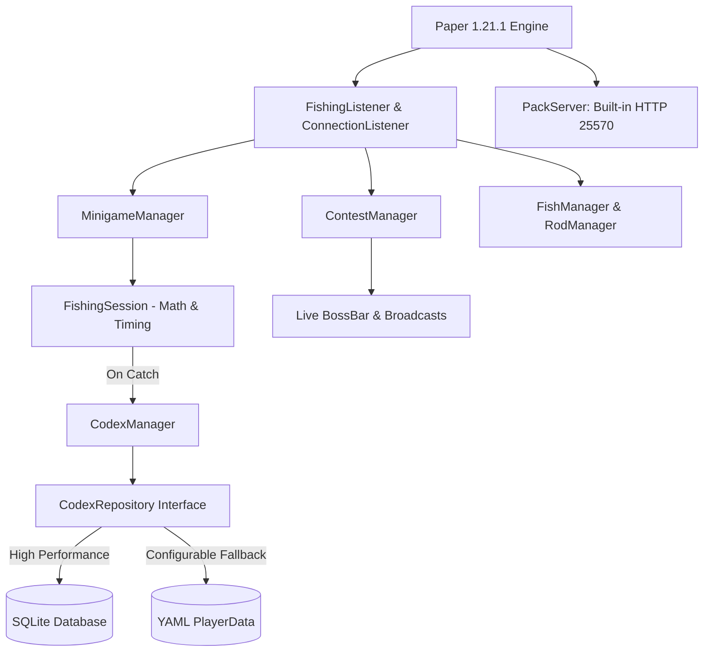

# AquaFishing 🎣

[](https://www.oracle.com/java/)
[](https://papermc.io/)
[](LICENSE)
[](https://github.com/efekkoc/AquaFishing/actions)
[]()

> 🇹🇷 **Türkçe Dokümantasyon için [README_TR.md](README_TR.md) dosyasına göz atabilirsiniz.**

**AquaFishing** is an enterprise-grade, high-performance, and feature-rich **RPG Fishing & Tournament** plugin engineered for modern Minecraft (**Paper 1.21.x**) servers.

It reinvents vanilla fishing into an engaging RPG gameplay loop featuring:
- **40 custom pixel-art fish species** with weight generation and collection log (Codex).
- **10-tier RPG fishing rods** with custom stats (bite rate reduction, catch power, luck, reeling speed).
- **Interactive skill-based timing minigame** with dynamic HUDs (BossBar & Action Bar).
- **Enterprise persistence architecture** using the **Repository Pattern** with high-throughput **SQLite** and **YAML** fallbacks.
- **Automated live tournaments** with real-time BossBar score tracking and rewards.
- **Built-in HTTP Resource Pack Server** (port 25570) with automatic SHA-1 hash verification.

---

## 🏛️ System Architecture

AquaFishing is built following clean code and domain-driven design principles:
- **Repository Pattern (Storage Abstraction):** Player progress is decoupled from the storage engine via `CodexRepository`. Out of the box, it provides a indexed, parameterized **SQLite** database implementation alongside standard YAML files.
- **Thread Safety & Async I/O:** Heavy disk persistence and database transactions run asynchronously via `BukkitScheduler` to protect the main server tick loop (20 TPS guarantee). Thread-safe memory caches utilize `ConcurrentHashMap`.
- **Type-Safe Data Integrity (PDC):** Items and fish attributes are strictly verified using Paper's native `PersistentDataContainer` (`NamespacedKey`) rather than fragile lore or display name parsing.
- **Unit Testing (JUnit 5):** Core mechanics—such as minigame cursor oscillation, RNG rarity distributions, and codex progression—are covered by unit test suites.
- **Automated CI/CD:** GitHub Actions workflow automatically checks out code, runs all unit tests, and packages release JAR artifacts on every push and PR.



---

## 🌟 Key Features

### 🐟 40 Custom Fish & Dynamic Weight Pools
- **4 Rarity Tiers**: `Common`, `Rare`, `Epic`, `Legendary`.
- Custom 32x32 textures via custom model data, unique weights, flavor lore, and PDC signatures.
- **Codex & Discovery Log**: `/fish book` GUI tracking caught species, total catches, and personal weight records.

### 🎣 10-Tier RPG Rods
Each tier provides distinct progression attributes:
1. **Apprentice Wooden Rod** (Tier I)
2. **Bamboo River Rod** (Tier II)
3. **Reinforced Iron Rod** (Tier III)
4. **Redstone Mechanical Rod** (Tier IV)
5. **Pure Gold Prosperity Rod** (Tier V)
6. **Deep Sea Amethyst Rod** (Tier VI)
7. **Prismarine Ocean Rod** (Tier VII)
8. **Master Diamond Rod** (Tier VIII)
9. **Netherite Magma Rod** (Tier IX)
10. **Ancient Dragon Rod** (Tier X - Mythic)

### 🎯 Skill-Based Timing Minigame
- When a fish bites, an interactive oscillating bar renders on the player's BossBar and Action Bar.
- The player must click when the cursor aligns with the green sweet spot.
- High-tier rods broaden the green zone and increase reeling speed.

### 💰 Direct Marketplace & Upgrade Shop
- **`/fish sell`**: Instantly liquidates caught fish into Gold Ingots based on rarity and weight.
- **`/fish shop`**: Interactive GUI displaying requirements (catch count, previous rod tier, gold cost) to upgrade rods.

### 📦 Built-In Resource Pack Distribution
- Eliminates external file hosting dependencies by running an embedded HTTP server on port 25570.
- Serves `AquaFishing-Pack.zip` with instant SHA-1 hash negotiation upon player join.

---

## 📜 Commands & Permissions

| Command | Description | Default Permission |
| :--- | :--- | :--- |
| `/fish sell` | Sells all tournament fish in player's inventory | Everyone |
| `/fish shop` | Opens the rod upgrade and marketplace GUI | Everyone |
| `/fish book` | Opens the player's fish discovery Codex | Everyone |
| `/fish top` | Displays the current live tournament leaderboard | Everyone |
| `/fish help` | Displays the help menu | Everyone |
| `/fish start [duration]` | Manually starts a tournament (e.g. `/fish start 300`) | `aquafishing.admin` |
| `/fish stop` | Stops an active tournament early | `aquafishing.admin` |
| `/fish give rod <id>` | Gives a specific custom rod | `aquafishing.admin` |
| `/fish give fish <id>` | Gives a specific custom fish | `aquafishing.admin` |
| `/fish reload` | Hot-reloads configuration files | `aquafishing.admin` |

---

## 🧪 Developer API & Custom Events

Other plugins can hook into AquaFishing events:

```java
import me.furkankoc.aquafishing.api.events.FishCaughtEvent;
import org.bukkit.event.EventHandler;
import org.bukkit.event.Listener;

public class MyCustomListener implements Listener {

    @EventHandler
    public void onFishCaught(FishCaughtEvent event) {
        String fishName = event.getFish().template().name();
        double weight = event.getFish().weight();
        event.getPlayer().sendMessage("Great catch! " + fishName + " (" + weight + " kg)");
    }
}
```

---

## 🛠️ Building & Testing

### Prerequisites
- **JDK 21** or newer
- **Gradle 8.x** (wrapper included)

### Compile & Run Tests
```bash
# Execute JUnit 5 unit test suites
./gradlew test

# Compile production JAR
./gradlew build
```

Compiled JAR file will be located at `build/libs/AquaFishing-1.0.0-SNAPSHOT.jar`.

---

## 📄 License

This project is licensed under the [MIT License](LICENSE) - see the LICENSE file for details.
