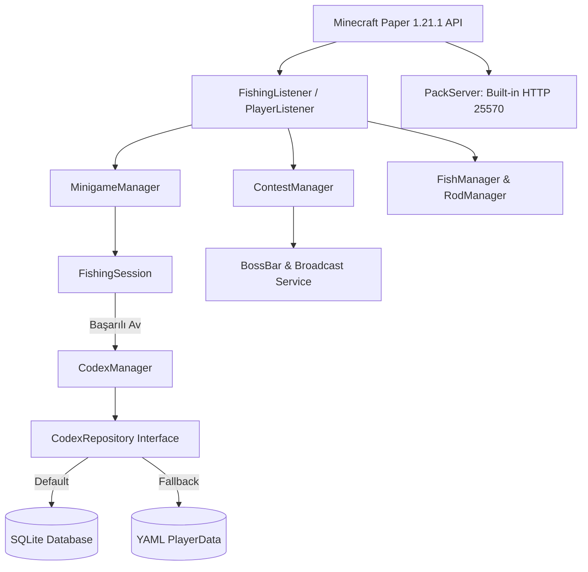

# AquaFishing 🎣 (Türkçe Dokümantasyon)

[](https://www.oracle.com/java/)
[](https://papermc.io/)
[](LICENSE)
[]()

> English documentation is available in [README.md](README.md).

**AquaFishing**, modern Minecraft (Paper 1.21.x) sunucuları için geliştirilmiş, yüksek performanslı, nesne yönelimli (OOP), test odaklı ve tam donanımlı bir **RPG Balıkçılık & Turnuva** eklentisidir.

Klasik vanilya balık tutma mekaniğini; 40 adet özel dokulu balık türü, 10 kademeli RPG oltaları, beceri odaklı zamanlama mini-oyunu (timing minigame), balık ansiklopedisi (Codex), SQLite / YAML veri saklama katmanı ve balıkçı pazarı ile zengin bir oyun döngüsüne dönüştürür.

---

## 🏛️ Mimari & Tasarım Prensipleri

AquaFishing, kurumsal seviyede yazılım geliştirme standartlarına uygun olarak tasarlanmıştır:
- **Repository Pattern & Persistence Abstraction:** Oyuncu keşifleri ve istatistikleri doğrudan YAML'a sıkışmak yerine `CodexRepository` arayüzü ile soyutlanmıştır. Varsayılan olarak yüksek hızlı **SQLite** (indexlenmiş ilişkisel tablolar) veya istenirse **YAML** depolama kullanılabilir.
- **Async Execution & Concurrency:** Tüm I/O ve disk yazma işlemleri sunucu ana döngüsünü (main tick loop) kitlememek adına `BukkitScheduler` asenkron iş parçacıkları ve `ConcurrentHashMap` önbellekleri üzerinde koşturulur.
- **PDC (PersistentDataContainer) Veri Doğrulaması:** Eşyaların özgünlüğü kırılgan metin/lore yerine Paper'ın yerel PDC API'si ile `NamespacedKey` üzerinden doğrulanır.
- **Unit Testing (JUnit 5):** Balık olasılık dağılımları, minigame ibre salınım matematiği ve oyuncu keşif mantığı %100 birim testleri ile taranmıştır.
- **Continuous Integration (CI/CD):** Her commit ve Pull Request, GitHub Actions üzerinde otomatik olarak Java 21 ile derlenip test edilir.



---

## ✨ Öne Çıkan Özellikler

### 🐟 40 Adet Özel Balık Türü & Nadirlik Seviyeleri
- **4 Farklı Nadirlik**: `Yaygın (Common)`, `Nadir (Rare)`, `Epik (Epic)`, `Efsanevi (Legendary)`.
- Her balık için özel 32x32 piksel dokusu, ağırlık havuzu (kg), özel lore ve `PersistentDataContainer` (PDC) kimlik doğrulaması.
- **Koleksiyon & Ansiklopedi (Codex)**: `/fish book` komutu ile tutulan balık türleri, yakalanma sayıları ve kırılan kişisel rekorlar kaydedilir.

### 🎣 10 Kademeli Özel RPG Oltaları
Her biri benzersiz piksel dokuya ve özel niteliklere (Yeşil Bar Gücü, Sarma Hızı, Vuruş Hızı, Nadir Balık Şansı) sahip 10 kademe:
1. **Çırak Tahta Oltası** (Kademe I)
2. **Bambu Nehir Oltası** (Kademe II)
3. **Takviyeli Demir Olta** (Kademe III)
4. **Kızıltaş Mekanik Olta** (Kademe IV)
5. **Saf Altın Bereket Oltası** (Kademe V)
6. **Derin Deniz Ametist Oltası** (Kademe VI)
7. **Prizmarin Okyanus Oltası** (Kademe VII)
8. **Usta Elmas Olta** (Kademe VIII)
9. **Netherite Magma Oltası** (Kademe IX)
10. **Melon Kadim Ejder Oltası** (Kademe X - Mitolojik)

### 🎯 Dinamik Sarma Mini-Oyunu (Timing Minigame)
- Balık oltaya vurduğunda BossBar ve Action Bar üzerinde dinamik bir hedef çubuğu belirir.
- Yeşil hedef alanına imleç denk geldiğinde sağ tıklayarak balığı çekme mekaniği.
- Üst kademe oltalar yeşil alanı genişletir ve sarma hızını artırır.

### 💰 Doğrudan Satış & Balıkçı Pazarı
- **`/fish sell`**: Envanterdeki tüm turnuva balıklarını tek komutla değerine göre doğrudan Altın Külçesi'ne çevirir.
- **`/fish shop`**: Oltaların gereksinimlerini inceleyip kademe atlama GUI menüsü.

### 🏆 Otomatik & Canlı Turnuva Sistemi
- Otomatik periyodik turnuva veya yönetici komutuyla anlık başlatma.
- Canlı **BossBar** göstergesi (kalan süre, lider ve en ağır balık).
- Yeni rekor duyuruları ve ilk 3'e giren oyunculara özelleştirilebilir ödüller.

### 📦 Dahili Kaynak Paketi Dağıtıcısı (Built-in HTTP Pack Server)
- Eklenti, port 25570 üzerinden dahili bir HTTP sunucusu açarak `AquaFishing-Pack.zip` paketini oyunculara otomatik ve güvenli (SHA-1 hash doğrulamalı) olarak iletir.

---

## 📜 Komutlar & Yetkiler

| Komut | Açıklama | Varsayılan Yetki |
| :--- | :--- | :--- |
| `/fish sell` | Envanterdeki tüm turnuva balıklarını doğrudan satar | Herkese açık |
| `/fish shop` | Balıkçı pazarını ve olta geliştirme menüsünü açar | Herkese açık |
| `/fish book` | Balıkçı ansiklopedisini (Codex GUI) açar | Herkese açık |
| `/fish top` | Anlık turnuva liderlik tablosunu gösterir | Herkese açık |
| `/fish help` | Komut listesini gösterir | Herkese açık |
| `/fish start [süre]` | Turnuvayı başlatır (Örn: `/fish start 300`) | `aquafishing.admin` |
| `/fish stop` | Devam eden turnuvayı erkenden bitirir | `aquafishing.admin` |
| `/fish give rod <id>` | Belirtilen özel oltayı verir | `aquafishing.admin` |
| `/fish give fish <id>` | Belirtilen özel balığı verir | `aquafishing.admin` |
| `/fish reload` | Eklenti konfigürasyonunu yeniler | `aquafishing.admin` |

---

## 🧪 Birim Testleri & CI/CD

Projeyi derlemek ve birim testlerini koşturmak için:

```bash
# Birim testlerini koşturmak için:
./gradlew test

# Projeyi derlemek için:
./gradlew build
```

Derlenen jar dosyası `build/libs/AquaFishing-1.0.0-SNAPSHOT.jar` konumunda oluşur.
Sunucunuzun `plugins/` klasörüne atıp yeniden başlatmanız yeterlidir.
